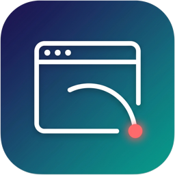

<p align="center"></p>

<h1 align="center"> cdp-relay</h1>

<p align="center">
いま開いている <b>ログイン済みの Chrome / Edge</b> を、AI エージェントにそのまま操作させるローカル中継。<br>
承認ダイアログで止まらず、会社・用途ごとの複数プロファイルを名前で使い分けられます。
</p>

<p align="center">
<a href="LICENSE"></a>


</p>

---

## 🤖 AI エージェントの方へ

ユーザーにこのリポジトリの URL を渡されて「使いたい」「入れて」と頼まれたら、**[INSTALL.md](INSTALL.md) の手順を上から順に実行してください**。
人の操作が必要なのは「拡張機能の読み込み」と「ブラウザ名の入力」だけで、それ以外はコマンドで完結します。

## なにができるか

- **普段のブラウザをそのまま使う** — Gmail・Slack・社内システムなど、ログイン済みのセッションのまま操作します。新しいブラウザや別プロファイルを作る必要はありません
- **承認ダイアログで止まらない** — Chrome / Edge 144 以降は DevTools ポートへの接続ごとに承認ダイアログが出ます。cdp-relay は拡張機能(`chrome.debugger`)経由なので、無人でも止まりません
- **複数プロファイルを名前で選ぶ** — `chrome-personal`、`edge-company-a` のように、会社・用途ごとのプロファイルを 1 つの中継で同時に扱えます。閉じているプロファイルもエージェントが開けます
- **ユーザーの作業を邪魔しない** — エージェントは自分用のタブを背面に開いて作業し、終わったら閉じるか、結果を見せるためにユーザーへ引き渡します
- **不可逆な操作の前で止まる(HumanGate)** — 送信・削除・購入などは人の確認を取ります。中継側でも、名前が不可逆に見えるボタンは明示の承認なしに押しません
- **放置されたダイアログを片付ける** — alert / confirm、Basic 認証、ファイル選択、ダウンロード、権限要求を、ポリシーに沿って自動処理し記録します
- **どのエージェントからも同じ動き** — MCP サーバー(依存なし)として提供。Claude Code はプラグインで、Codex / Gemini CLI / Cursor / Antigravity などは MCP の設定で使えます。puppeteer / Playwright からも普通の CDP エンドポイントとして繋がります

## しくみ

```
 AI エージェント(Claude Code / Codex / Gemini CLI …)
   │ MCP(stdio)
   ▼
 plugin/cdp-relay/mcp/server.mjs … 依存なしのシム
   │ Unix ソケット ~/.cdp-relay/relay-9333.sock(0600)
   ▼
 relay/server.mjs … 常駐中継(LaunchAgent、127.0.0.1:9333)        ← puppeteer / Playwright も CDP で接続可
   │ WebSocket
   ▼
 extension/ … 拡張機能「CDP Relay Bridge」(プロファイルごとに 1 つ、chrome.debugger)
```

## 必要なもの

- macOS(常駐化とプロファイルを開く処理が macOS 専用です)
- Node.js 22 以上、[pnpm](https://pnpm.io/)
- Google Chrome または Microsoft Edge(Chrome 152 / Edge 152 で動作確認)

## インストール

詳しい手順と、うまくいかないときの対処は [INSTALL.md](INSTALL.md) にあります。

```bash
git clone https://github.com/Haratakeshi/cdp-relay.git ~/cdp-relay
cd ~/cdp-relay
pnpm install --frozen-lockfile
pnpm run setup        # 常駐中継を入れて起動し、状態と次の一手を表示する(何度実行してもよい)
```

続いて、使いたいブラウザ(プロファイル)ごとに拡張機能を読み込みます。

1. `chrome://extensions`(Edge は `edge://extensions`)で「デベロッパーモード」を ON
2. 「パッケージ化されていない拡張機能を読み込む」で `~/cdp-relay/extension` を選ぶ
3. ツールバーの CDP Relay Bridge のアイコンを押し、ブラウザ名(例 `chrome-personal`)を入れて保存

最後にエージェントへ登録します。Claude Code なら:

```bash
claude plugin marketplace add ~/cdp-relay
claude plugin install cdp-relay@cdp-relay
```

ほかの MCP クライアントは `pnpm run setup` が表示する設定(`node ~/cdp-relay/plugin/cdp-relay/mcp/server.mjs` を stdio で起動)を登録します。

## 使い方

エージェントに普通に頼むだけです。

> cdp-relay で chrome-personal を使って、Gmail の未読から請求書のメールを探して一覧にして

エージェントは `browser_list` → `tab_open` → `snapshot` → `act` → `read` の順に操作し、終わるとタブを閉じます。
メールの送信のような不可逆な操作の前では止まり、確認を求めます。ツールの一覧は [docs/PLUGIN.md](docs/PLUGIN.md) にあります。

拡張のアイコンには状態が出ます。

| バッジ | 意味 |
|---|---|
| (なし) | 中継に接続中・待機中 |
| 数字 | デバッガを接続しているタブの数(エージェントが操作中) |
| `OFF` | 中継に未接続(再接続を試行中)。`pnpm run setup` で確認 |
| `!` | ブラウザ名が未設定 |

エージェントがタブに接続している間、ブラウザ上部に「デバッグしています」のバーが出ます。セッションが終わると消えます。

## セキュリティ

cdp-relay は、**ログイン済みのブラウザを丸ごと操作できる入口**をローカルに開きます。使う前に [SECURITY.md](SECURITY.md) を読んでください。要点:

- 中継は `127.0.0.1` だけで待ち受けます。LAN やインターネットに公開しないでください(`CDP_RELAY_HOST` を変えない)
- 中継の TCP ポートに繋げる**同じ Mac 上のプロセスは、認証なしで**登録済みのブラウザを操作できます
- 拡張機能は `debugger` と全サイトへのアクセス権を持ちます。信頼できるエージェントにだけ使わせてください

## ドキュメント

| 文書 | 内容 |
|---|---|
| [INSTALL.md](INSTALL.md) | 導入手順(エージェントがそのまま実行できる形)、更新、アンインストール、トラブルシュート |
| [docs/PLUGIN.md](docs/PLUGIN.md) | エージェント向け MCP の考え方・ツール・ライフサイクル |
| [docs/REFERENCE.md](docs/REFERENCE.md) | ポート設計、自動処理のポリシー、CLI、CDP クライアントからの接続、テスト、制約 |
| [docs/DESIGN.md](docs/DESIGN.md) | 設計メモ |
| [docs/EXPERIMENT_LOG.md](docs/EXPERIMENT_LOG.md) | Chrome の挙動の実測記録 |
| [SECURITY.md](SECURITY.md) | 脅威モデルと脆弱性の報告方法 |

## ライセンス

[MIT](LICENSE)
